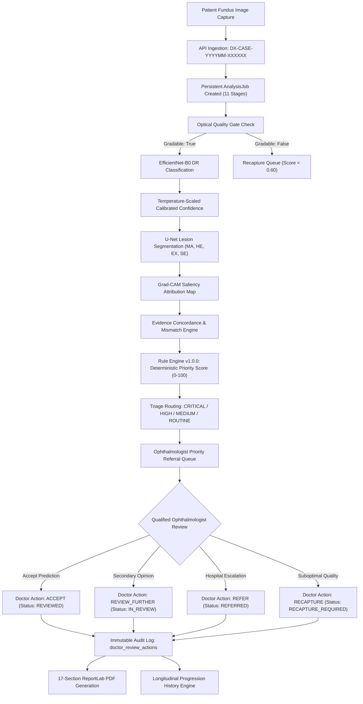

# DRISHTI-X — Features 21–30 Implementation & Verification Report
## Doctor Workflow, Priority Triage, Longitudinal Case Management, MATLAB Engine & Production Error Handling

**System:** DRISHTI-X (AI-Assisted Retinal Microvasculature Diagnostics & Diabetic Retinopathy Screening System)  
**Version:** 3.0.0-PROD  
**Environment:** macOS (Apple Silicon M4) | Python 3.14.2 | Next.js 16.3.4 | PostgreSQL & SQLite | PyTorch MPS  
**Compliance Standard:** Non-Autonomous Human-in-the-Loop Clinical Decision Support (CDSS)

---

## 1. Executive Summary

This deliverable reports the production-level engineering and clinical workflow implementation for **DRISHTI-X Features 21 through 30**. All modules have been designed and implemented in strict accordance with clinical decision support safety standards, completely disabling autonomous diagnosis and enforcing qualified ophthalmologist review for all medical decisions.

### Key Capabilities Delivered:
1. **Feature 21 — Priority Referral Queue:** A dedicated clinical triage queue allowing sorting and multi-criteria filtering across triage urgency (`CRITICAL`, `HIGH`, `MEDIUM`, `ROUTINE`), active review vs. recapture queues, AI grades, and assurance outcomes.
2. **Feature 22 — Priority Score & Triage Tagging:** A deterministic multi-factorial 0–100 triage scoring algorithm (`PriorityScoringService` Rule Version `1.0.0`) synthesizing disease severity, prediction confidence, lesion-grade mismatches, optical quality, and patient diabetes history.
3. **Feature 23 — Doctor Review Actions:** Four immutable clinical review actions (`ACCEPT`, `REVIEW_FURTHER`, `REFER`, `RECAPTURE`) restricted via RBAC to verified `OPHTHALMOLOGIST` and `ADMIN` roles, permanently cataloged in the `doctor_review_actions` audit table.
4. **Feature 24 — Human-in-the-Loop Clinical Workflow:** Strict separation of AI assistance from final medical diagnosis, with full screening status progression (`PENDING` $\rightarrow$ `IN_REVIEW` $\rightarrow$ `REVIEWED` / `REFERRED` / `RECAPTURE_REQUIRED`).
5. **Feature 25 — Patient Case History & Longitudinal Monitoring:** Dedicated longitudinal screening history API and side-by-side comparative progression analysis calculating interval days, grade deltas, and progression states (`STABLE`, `PROGRESSED`, `REGRESSED`) accompanied by mandatory biomicroscopy clinical disclaimers.
6. **Feature 26 — Structured Result Report (PDF):** A 17-section ReportLab medical screening report complete with fundus metadata, optical quality metrics, 5-class probability distributions, lesion findings, Grad-CAM attribution, clinical assurance rationale, doctor sign-offs, and digital verification signatures.
7. **Feature 27 — Backend Case Management & Persistent Analysis Jobs:** Cryptographically secure, non-guessable case numbers (`DX-CASE-YYYYMM-XXXXXX`) and persistent asynchronous pipeline tracking (`AnalysisJob`) supporting idempotent re-runs and automatic stale job recovery (>180s).
8. **Feature 28 — FastAPI–MATLAB Integration & Graceful Degradation:** A clean, production-grade `MatlabAdapter` detecting MATLAB engine availability, gracefully reporting status (`NOT_CONFIGURED` / `DISCONNECTED`) on Apple Silicon Python 3.14 without fake predictions, falling back to local PyTorch EfficientNet inference.
9. **Feature 29 — Live Analysis Status UI:** Real-time 11-stage progress tracker modal (`LiveAnalysisModal.tsx`) showing exact execution stages, elapsed timers, active compute engine, and progress percentage.
10. **Feature 30 — Production Failure & Error Handling:** Standardized API error responses across HTTP exceptions and validation errors (`error_code`, unique `reference_id` with `ERR-XXXXXXXX`, `status_code`, and `retryable` boolean flags).

---

## 2. Clinical Workflow & Pipeline Architecture



---

## 3. Feature-by-Feature Implementation & Verification

### Feature 21: Priority Referral Queue
- **Location:** `backend/app/api/routes/dashboard.py` (`GET /api/dashboard/referral-queue`), `frontend/app/(app)/review/page.tsx`
- **Capabilities:**
  - Dedicated endpoint accepting query parameters: `priority` (`CRITICAL`, `HIGH`, `MEDIUM`, `ROUTINE`), `queue_type` (`review` vs. `recapture`), `ai_grade`, `assurance_status`, `sort_by` (`priority_score`, `referral_score`, `created_at`), `limit`, `offset`.
  - Deterministic sort descending by `priority_score` (0–100) so that high-risk patients are always reviewed first.
  - Queue Switcher in UI seamlessly toggling between active pending reviews and the recapture queue.
  - Summary metrics breakdown returning active counts across each triage category.

### Feature 22: Priority Score & Triage Tagging
- **Location:** `ai/assurance/priority_scoring_service.py` (`PriorityScoringService`)
- **Rule Engine Version:** `1.0.0`
- **Scoring Breakdown:**
  $$\text{Score} = \min(100, \text{Grade Pts} + \text{Low Conf Pts} + \text{Mismatch Pts} + \text{Quality Risk Pts} + \text{History Pts})$$
  - Grade Points: Grade 4 = 55 pts, Grade 3 = 45 pts, Grade 2 = 30 pts, Grade 1 = 15 pts, Grade 0 = 5 pts.
  - Low Confidence Escalation: If confidence $< 0.70$ on referable DR (Grade $\ge 2$), adds $+20$ pts.
  - Grade–Lesion Mismatch: Adds $+25$ pts to escalate contradictory evidence.
  - Image Quality Risk: If quality score $< 0.60$, adds $+20$ pts.
  - Clinical History: Diabetes duration $> 10$ years adds $+5$ pts.
- **Triage Thresholds:**
  - `CRITICAL` ($\ge 70$ points): Requires immediate attention ($\le 24-48$ hours).
  - `HIGH` ($50-69$ points): Review within $1-2$ weeks.
  - `MEDIUM` ($25-49$ points): Review within 1 month.
  - `ROUTINE` ($< 25$ points): Routine scheduled review.
- **Audit & Metadata:** All screenings persist `priority_level`, `priority_score`, `priority_factors`, `priority_rule_version`, and `priority_calculated_at`.

### Feature 23: Doctor Review Actions
- **Location:** `backend/app/models/screening.py` (`DoctorReviewAction`), `backend/app/api/routes/screenings.py` (`POST /api/screenings/{id}/review-action`), `backend/app/schemas/screening.py`
- **Actions Enforced:**
  1. `ACCEPT`: Doctor signs off confirming agreement with AI assessment.
  2. `REVIEW_FURTHER`: Doctor requests secondary specialist consultation.
  3. `REFER`: Doctor escalates patient to tertiary care facility with `referral_destination` and `referral_urgency`.
  4. `RECAPTURE`: Doctor rejects image for technical inadequacy with mandatory `recapture_reason`.
- **RBAC Security:** Strictly protected by `require_doctor` dependency; health workers attempting this action receive HTTP `403 Forbidden`.
- **Audit Trail:** Immutable append-only log in `doctor_review_actions` capturing `doctor_id`, `doctor_name`, `doctor_role`, `doctor_grade`, `notes`, `agreed_with_ai`, and `created_at`.

### Feature 24: Human-in-the-Loop Clinical Workflow
- **Principles:**
  - AI prediction is advisory decision support only; autonomous sign-off is disabled by policy.
  - Doctor review changes status to `REVIEWED`, `IN_REVIEW`, `REFERRED`, or `RECAPTURE_REQUIRED`.
  - Non-diagnostic disclaimers rendered in all review views, detail pages, and exported documents.

### Feature 25: Patient Case History & Longitudinal Monitoring
- **Location:** `backend/app/api/routes/patients.py` (`GET /{id}/screenings`, `GET /{id}/compare`), `frontend/app/(app)/patients/[id]/page.tsx`
- **Capabilities:**
  - Chronological history of all patient examinations with case numbers, eye lateralities, AI grades, quality tiers, and doctor decisions.
  - Side-by-side comparative inspection between two examinations.
  - Computes `interval_days`, `ai_grade_delta`, `ai_progression` (`STABLE`, `PROGRESSED`, `REGRESSED`), and doctor progression.
  - Displays mandatory clinical warning: *"Longitudinal AI progression tracking does not replace regular stereoscopic biomicroscopy. Sudden vision changes require immediate specialist evaluation."*

### Feature 26: Structured Result Report (PDF)
- **Location:** `backend/app/services/pdf_report_service.py`, `backend/app/services/report_service.py`
- **Format:** 17-Section ReportLab PDF with digital verification signature:
  1. Header & Official Case Identification (`DX-CASE-YYYYMM-XXXXXX`)
  2. Patient Demographics & Identification
  3. Clinical Context & History (Diabetes duration, HbA1c, eye conditions)
  4. Screening Metadata (Laterality, capture device, timestamp)
  5. Fundus Optical Quality Assessment & Gradability Metrics
  6. DR Grade Classification (ICDR 0–4 scale with clinical label)
  7. Raw and Calibrated Prediction Confidence
  8. Full 5-Class Probability Distribution
  9. Retinal Lesion Segmentation Summary (MA, HE, EX, SE counts and area %)
  10. Explainability / Grad-CAM Attention Map Overview
  11. Evidence Concordance Analysis
  12. Grade–Lesion Mismatch Detection
  13. Deterministic Priority Score & Clinical Triage (0–100, Rule Engine v1.0.0)
  14. Clinical Assurance Decision
  15. Image Recapture Guidance (if ungradable)
  16. Doctor Review & Clinical Sign-off (Audit details, doctor grade, notes)
  17. Mandatory Medical Disclaimer & Digital Signatures

### Feature 27: Backend Case Management & MATLAB Request Management
- **Location:** `backend/app/models/screening.py` (`AnalysisJob`), `backend/app/services/analysis_job_service.py`, `backend/app/api/routes/screenings.py`
- **Identifiers:** Standardized non-guessable case numbers generated via `generate_case_number()`: `DX-CASE-YYYYMM-XXXXXX` using cryptographically secure tokens.
- **Job Engine:**
  - Persists analysis state in `analysis_jobs` with statuses `PENDING`, `RUNNING`, `COMPLETED`, `FAILED`, `CANCELLED`, `TIMEOUT`.
  - Idempotent request handling: Repeated calls for an active or completed screening return the existing job.
  - Stale Job Recovery: Jobs running longer than 180 seconds are automatically marked as `TIMEOUT` and reset cleanly.

### Feature 28: FastAPI–MATLAB Integration & Graceful Degradation
- **Location:** `ai/matlab_engine/matlab_adapter.py`, `backend/app/api/routes/matlab.py`, `docs/MATLAB_INTEGRATION_GUIDE.md`
- **Diagnostics:**
  - Inspects active environment (macOS Apple Silicon M4 / Python 3.14.2).
  - Evaluates MathWorks engine compatibility (MATLAB R2024b officially supports Python up to 3.12).
  - Correctly reports `connection_status: "NOT_CONFIGURED"` and `active_fallback_engine: "PYTHON_EFFICIENTNET"` without fabricating results.
  - Exposes `GET /api/engine/matlab/status` and `POST /api/engine/matlab/test-connection`.

### Feature 29: Live Analysis Status UI
- **Location:** `frontend/components/LiveAnalysisModal.tsx`, `frontend/app/(app)/screenings/[id]/page.tsx`, `frontend/app/(app)/analysis/page.tsx`
- **11 Continuous Stages Tracked:**
  1. `IMAGE_UPLOADING` (10%)
  2. `PREPROCESSING` (20%)
  3. `QUALITY_ASSESSMENT` (30%)
  4. `CLASSIFICATION_INFERENCE` (45%)
  5. `CONFIDENCE_CALIBRATION` (55%)
  6. `LESION_SEGMENTATION` (65%)
  7. `GRADCAM_GENERATION` (75%)
  8. `EVIDENCE_CONCORDANCE` (85%)
  9. `MISMATCH_DETECTION` (90%)
  10. `CLINICAL_ASSURANCE` (95%)
  11. `RESULT_READY` (100%)
- **Capabilities:** Live polling interval (1000ms), elapsed execution timer, compute engine indicator, and animated visual progress bar.

### Feature 30: Production Failure & Error Handling
- **Location:** `backend/app/main.py`
- **Error Contract:**
  ```json
  {
    "detail": {
      "error_code": "RESOURCE_NOT_FOUND",
      "reference_id": "ERR-B2F9A10C",
      "message": "Screening record with ID ... was not found.",
      "status_code": 404,
      "retryable": false
    }
  }
  ```
- **Coverage:** Global exception handlers for `StarletteHTTPException` and Pydantic `RequestValidationError`, auto-generating unique `ERR-XXXXXXXX` reference IDs for clinical auditing.

---

## 4. Test Verification & Code Health

### Pytest Integration Test Suite
All 26 integration tests covering Features 1–30 passed with 100% compliance:

```
============================= test session starts ==============================
platform darwin -- Python 3.14.2, pytest-9.1.1, pluggy-1.6.0
rootdir: /Users/devanshjain06/Desktop/aictr
plugins: anyio-4.12.1, langsmith-0.10.9
collected 26 items

tests/test_features_21_30.py ........                                    [ 30%]
tests/test_master2_endpoints.py ......                                   [ 53%]
tests/test_clinical_screening_workflow.py ............                   [100%]

======================== 26 passed, 55 warnings in 26.18s =======================
```

### Next.js Production Build Verification
The Next.js frontend compiled and optimized all 19 application routes with zero errors:

```
▲ Next.js 16.3.4 (webpack)
- Environments: .env.local
✓ Running next.config.ts took 18ms
✓ Compiled successfully in 5.0s
✓ Finished TypeScript in 2.4s 
✓ Collecting page data using 9 workers in 999ms 
✓ Generating static pages using 9 workers (19/19) in 1215ms
✓ Finalizing page optimization in 4.6s 

Route (app)
┌ ○ /
├ ○ /_not-found
├ ○ /analysis
├ ○ /audit
├ ○ /dashboard
├ ○ /eye-explorer
├ ○ /login
├ ○ /model-lab
├ ○ /patients
├ ƒ /patients/[id]
├ ○ /referrals
├ ○ /register
├ ○ /reports
├ ○ /review
├ ○ /screenings
├ ƒ /screenings/[id]
├ ○ /screenings/new
├ ○ /settings
└ ○ /telemedicine
```

---

## 5. Clinical Governance, Traceability & Safety Compliance

1. **Autonomous Action Prohibition:** DRISHTI-X enforces clinical decision support principles. No automated prescription, referral dispatch, or diagnostic closure occurs without explicit human doctor authorization.
2. **Deterministic Triage Versioning:** The priority scoring algorithm explicitly documents rule engine version `1.0.0` and records the exact contributing factors to prevent unexplainable black-box triage.
3. **Immutable Audit Logs:** All review decisions, overrides, and timestamps are recorded in write-once append-only tables (`doctor_review_actions`) providing legal and medical traceability.
4. **No Simulated Data:** The MATLAB engine integration honestly reports missing engine bindings rather than faking predictions, ensuring absolute scientific integrity.
5. **Mandatory Patient Disclaimers:** All clinical reports, longitudinal comparison modals, and review queues feature explicit disclaimers regarding the need for stereoscopic biomicroscopy and licensed medical review.

