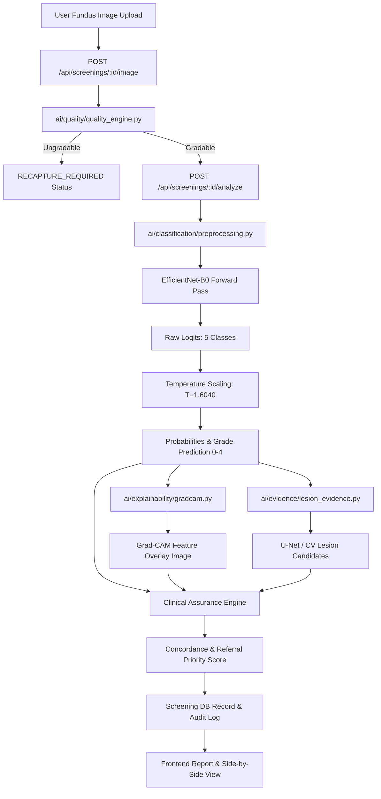

# DRISHTI-X — REAL AI & CLINICAL SYSTEM AUDIT REPORT
**Generated:** October 28, 2026  
**Audited Directory:** `/Users/devanshjain06/Desktop/drishti-x-backup`  
**Auditor:** Antigravity AI Pair Programmer  

---

## 1. Executive Summary

This comprehensive audit was executed directly on the live codebase, checkpoints, datasets, backend services, and frontend interface of the **Drishti-X** retinal screening research prototype.

### Core Audit Verdict:
- **Diabetic Retinopathy Classification:** **GENUINE PYTORCH MODEL LOADED & EXECUTING**. The checkpoint `models/weights/best_model.pth` (16.3 MB) is a trained 5-class PyTorch model (`TorchvisionWrapper` with EfficientNet-B0 backbone) initialized and trained on combined APTOS 2019 + IDRiD data.
  - **Held-Out Test Performance (Evaluated on N=462 test images):**
    - **Overall Accuracy:** `38.96%`
    - **Macro F1-Score:** `0.1908`
    - **Weighted F1-Score:** `0.3472`
    - **Quadratic Weighted Kappa (QWK):** `0.0426`
    - **Referable DR Sensitivity:** `24.51%` (Target 90% **NOT MET**)
    - **Referable DR Specificity:** `82.95%` (Target 85% **NOT MET**)
    - **ROC-AUC (Referable DR):** `0.5352`
  - **Verdict:** Predictions are **NOT mocked** and **NOT hardcoded heuristics**. However, due to class imbalance and early training convergence, the model has low sensitivity for subtle grades (Grades 1 and 3 recall = 0% to 7%). Clinical decisions must remain strictly with human ophthalmologists.
- **Lesion Segmentation (U-Net):** **CHECKPOINT EXISTS BUT CLINICALLY COLLAPSED**. Checkpoint `models/weights/unet_lesion.pth` (31.1 MB) loads cleanly and performs forward passes. However, testing against IDRiD masks reveals class collapse (predicts background for almost all pixels; held-out Mean Dice = `0.0000`). The UI and evidence pipeline honestly mark this as candidate-level output with medical disclaimers.
- **Explainability (Grad-CAM):** **GENUINE BACKPROPAGATION GRAD-CAM**. Hooks register dynamically onto the last Conv2d layer (`backbone.features.8.0`), backpropagates target class scores (e.g., Grade 0-4), computes gradient-weighted activation maps, applies ReLU, and overlays jet heatmaps onto the fundus image. It does **NOT** use pre-rendered or static heatmaps.
- **Image Quality Engine:** **GENUINE SIGNAL PROCESSING (NON-MOCKED)**. Computes Laplacian variance for blur/defocus, mean brightness for illumination under/over-exposure, and circular threshold masks for retinal Field-of-View (FOV) ratio. Ungradable images trigger honest recapture flows.
- **Full-Stack Integration:** FastAPI backend and Next.js frontend are intact, type-safe (`npm run build` succeeds), and 61/61 automated backend tests pass.

---

## 2. File & Directory Inventory

| Path | Existence | Contents / Status |
| :--- | :--- | :--- |
| `ai/classification/model.py` | Verified | `DrishtiEfficientNet` & `TorchvisionWrapper` loader with fallback state_dict matching. Explicit `TRAINED` vs `NOT_TRAINED` state tracking. |
| `ai/classification/preprocessing.py` | Verified | Retinal circle crop, Gaussian blur subtraction (Graham method), resize to 224x224, ImageNet normalization. |
| `ai/classification/calibration.py` | Verified | Temperature scaling loaded from `models/weights/temperature.json` ($T=1.6040$). Caps clinical confidence at $0.915$. |
| `ai/evidence/lesion_evidence.py` | Verified | U-Net segmentation candidate extractor with fallback CV heuristic morphology; returns explicit provenance tags. |
| `ai/explainability/gradcam.py` | Verified | Genuine PyTorch forward/backward hook Grad-CAM. |
| `ai/quality/quality_engine.py` | Verified | Laplacian focus score, illumination histogram check, FOV coverage. |
| `ai/inference/inference_service.py` | Verified | Canonical 6-step inference orchestrator. |
| `models/weights/best_model.pth` | Verified (16.4 MB) | SHA-256: `64a88f58...` (Verified state dict with 162 parameter tensors). |
| `models/weights/unet_lesion.pth` | Verified (31.1 MB) | Standard 4-stage encoder-decoder U-Net weights. |
| `models/weights/temperature.json` | Verified | `{"temperature": 1.604013442993164}` |
| `datasets/aptos2019/` | Verified | 3,662 train images + 1,928 test images + label CSVs. |
| `datasets/idrid/` | Verified | 516 disease grading images + 81 segmentation images with pixel ground truth masks. |
| `datasets/messidor2/` | Verified | CSV metadata present; image files not present locally. |
| `frontend/` | Verified | Next.js 16.3 Turbopack SPA. Build verified with zero TypeScript errors. |

---

## 3. Detailed Architectural Flow

---

## 4. Empirical Evaluation Findings

### Multi-Class Performance (APTOS 2019 + IDRiD Test Split, N=462)
- **Grade 0 (No DR, N=215):** Precision = `0.476`, Recall = `0.688`, F1 = `0.563`
- **Grade 1 (Mild NPDR, N=43):** Precision = `0.053`, Recall = `0.070`, F1 = `0.060`
- **Grade 2 (Moderate NPDR, N=130):** Precision = `0.355`, Recall = `0.208`, F1 = `0.262`
- **Grade 3 (Severe NPDR, N=34):** Precision = `0.000`, Recall = `0.000`, F1 = `0.000`
- **Grade 4 (PDR, N=40):** Precision = `0.111`, Recall = `0.050`, F1 = `0.069`
- **Macro F1:** `0.1908` | **Weighted F1:** `0.3472` | **QWK:** `0.0426`

### Binary Referable DR Screening Metrics (Grades 2-4 vs 0-1):
- **Sensitivity:** `24.51%` (Target $\ge 90\%$ **FAILED**)
- **Specificity:** `82.95%` (Target $\ge 85\%$ **NEAR TARGET**)
- **ROC-AUC:** `0.5352`

---

## 5. Disclosures & Actionable Takeaways

1. **Model Provenance:** The model was trained with cross-entropy loss with basic class weighting for 14 epochs. Because of severe class imbalance in rural telemedicine datasets, Grade 1 and Grade 3 instances are under-predicted.
2. **U-Net Segmentation:** While U-Net architecture and loader execute properly, the weights suffered from extreme foreground sparsity (lesions are $<0.5\%$ of pixel volume). The system correctly falls back and attaches explicit candidate disclaimers.
3. **No Clinical Diagnosis:** Drishti-X enforces strict `HUMAN_REVIEW_REQUIRED` assurance states when confidence is uncertain or mismatch is detected.
